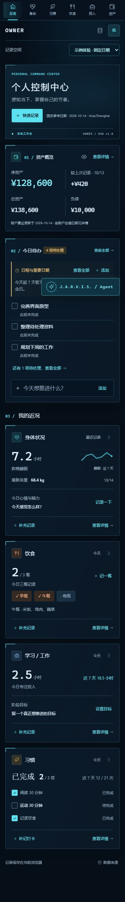
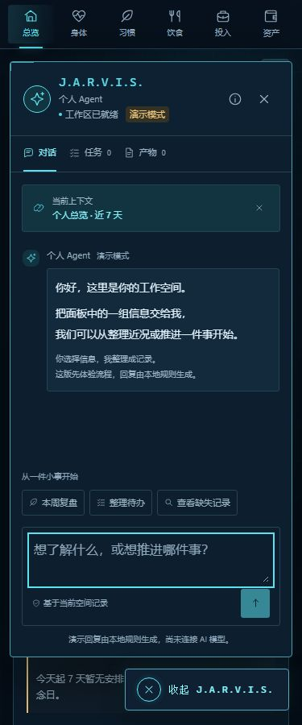

# Owner · 个人工作台

把身体、习惯、饮食、学习 / 工作与资产放进同一个工作台，记录当下，查看变化，推进每天的行动。

Owner 是一个采用贾维斯 HUD 风格的独立浏览器应用：深蓝底色、青色数据线、环形核心，以及右侧点击展开的个人 Agent 工作窗。当前以本地记录为主，数据保存在当前浏览器；Agent 由本地规则生成演示回复。

[快速开始](#快速开始) · [界面预览](#界面预览) · [功能概览](#功能概览) · [数据与备份](#数据与备份) · [阶段总结](docs/STAGE_SUMMARY_2026-10-28.md)

## 当前状态

- **第一版已交付**：[v1.0.0](https://github.com/Zzhi66/Owner/releases/tag/v1.0.0) 完成 P0–P4，包含正式日期、本地存储、记录管理、备份恢复和统计图表。
- **main 持续改进**：已加入导航光条、内容过渡、滚动位置记忆和快速切换保护；这些改进尚未单独发布新版本。
- **验证基线**：139 项自动测试、16 项独立 Chromium 验收；Linux / Windows / Chromium CI 见 [验证工作流](https://github.com/Zzhi66/Owner/actions/workflows/verify.yml)。首版交付时的浏览器用例为 10 项，后续导航新增 6 项。

具体成果和下一阶段建议见 [阶段总结](docs/STAGE_SUMMARY_2026-10-28.md)，版本变化见 [CHANGELOG](CHANGELOG.md)。

## 快速开始

使用 **Node.js 22.13+ 或受依赖支持的 24+**；当前开发和 CI 验证版本为 **22.22.0**，记录在 [.nvmrc](.nvmrc)。

```sh
git clone https://github.com/Zzhi66/Owner.git
cd Owner
npm ci
npm run dev
```

打开 [http://127.0.0.1:4173/#overview](http://127.0.0.1:4173/#overview)。Windows 若 PowerShell 限制 npm.ps1，可将命令中的 `npm` 换为 `npm.cmd`。

首次使用可以选择「示例体验」浏览界面，再切回「正式记录」开始录入。正式空间默认空数据；示例记录与个人记录分别保存。

生产构建与本地预览：

```sh
npm run build
npm start
```

预览地址为 [http://127.0.0.1:5175/#overview](http://127.0.0.1:5175/#overview)。服务只绑定本机，端口占用时会报错；先确认是否已有 Owner 服务在运行。构建产物通过 HTTP 服务打开。

> **保持固定的数据来源。** 4173 与 5175、`localhost` 与 `127.0.0.1`、不同浏览器的记录相互隔离。日常使用尽量保持原浏览器和 `http://127.0.0.1:4173`，切换来源前先导出完整备份。

## 界面预览

以下截图来自 v1.0.0 的独立示例空间，固定参考日期为 2026-10-14，不含个人记录。


<details>
<summary>查看窄屏总览与 Agent 工作窗</summary>

| 窄屏总览 | 个人 Agent |
| --- | --- |
|  |  |

</details>

## 功能概览

总览按 **资产 → 今日待办 / 日程 → 个人近况** 排列。总览看摘要，领域详情查看历史和完整记录。

| 模块 | 已支持的能力 |
| --- | --- |
| 身体与心情 | 睡眠、体重、步数、心情和精力；按日期记录、查看趋势 |
| 饮食 | 餐食、餐次与估算热量；保留未知热量和零值的区别 |
| 学习 / 工作 | 专注投入、项目统计、最多 3 个阶段目标；下一步可加入待办并去重 |
| 习惯 | 自定义、改名、停用 / 启用、打卡；按历史计划计算完成率和热力图 |
| 资产 | 人民币账户、资产 / 负债、金额隐藏、账户快照与估值历史 |
| 待办与日程 | 快速添加、撤销、完成和编辑；支持单次全天或本地时间日程 |
| 随手记 | 快速记录、查看、编辑、删除与回收站恢复 |
| 个人 Agent | 右侧展开，包含对话、任务和产物；本地规则演示、复制及 Markdown 导出 |

领域详情支持近 7 / 30 天。ECharts 图表按需加载，配有日期范围、单位、来源和可键盘打开的数据表；缺失不补零，估值历史不冒充交易流水，隐藏金额会同步隐藏相关资产图表及数值表。

近况卡片支持点击、触屏、拖动和键盘排序。导航保留 hash、刷新及前进后退，并在当前标签会话内按空间和模块记住滚动位置；动效适配减少动态效果偏好。见 [导航体验](docs/NAVIGATION.md)。

## 数据与备份

| 记录空间 | 日期口径 | 用途 |
| --- | --- | --- |
| 正式记录 | 设备本地日期 | 保存个人记录，默认空数据 |
| 示例体验 | 固定 2026-10-14 | 独立体验示例，不进入正式统计 |
| 原型记录 | 固定 2026-10-14 | 预览并复制旧 localStorage，保留原日期和来源 |

数据保存在当前浏览器 IndexedDB。保存失败保留草稿，过期编辑不能静默覆盖其他页面的修改；普通删除进入回收站，恢复冲突时保留当前数据。

**备份入口：个人设置 → 备份与恢复。**

- 导出完整备份，包含各空间记录、偏好、账户快照、回收站、恢复点和旧原文。
- 导入先校验并预览，默认建立独立恢复副本；替换当前空间及回退前会先保存恢复点。
- 完整备份格式为 v1，上限 **20 MiB**。旧版「导出当前显示记录」仅供查看，不能作为完整恢复文件。

有旧记录时，先进入只读迁移报告；核对后复制到原型空间，也可按领域和日期选择复制到正式空间。旧 key 与损坏原文均保留，不通过清空旧记录完成迁移。

日常操作与统计口径见 [数据口径与恢复指南](docs/DATA_AND_RECOVERY.md)；迁移及事务细节见 [P2](docs/P2_DATE_STORAGE.md)，完整恢复边界见 [P3](docs/P3_RECORDS_BACKUP.md)。

## 技术栈

| 层级 | 当前使用 |
| --- | --- |
| 界面与构建 | React、TypeScript、Vite |
| 样式与动效 | CSS 变量、分文件全局样式、原生 View Transitions / Web Animations |
| 本地数据 | IndexedDB / Dexie、Zod 校验、存储接口与事务 |
| 可视化 | Apache ECharts、SVG；图表按类型延迟加载 |
| 验证 | Vitest、React Testing Library、fake-indexeddb、Playwright |
| 代码质量与 CI | TypeScript、ESLint、Prettier、GitHub Actions |

精确版本与依赖以 [package.json](package.json) 和锁文件为准。目录与数据流说明见 [开发指南](docs/DEVELOPMENT.md)。

## 开发与验证

| 命令 | 用途 |
| --- | --- |
| `npm run dev` / `npm run dev:app` | React 开发服务，4173 |
| `npm run dev:prototype` | 保留的手写原型，4174 |
| `npm run build` | 类型检查、构建到 build/、原型保护与生产审计 |
| `npm start` / `npm run preview:app` | 构建后的生产预览，5175 |
| `npm run check` | 原型及服务 JavaScript 语法检查 |
| `npm run verify` | 语法、lint、格式、139 项自动测试、类型和构建 |
| `npm run test:e2e` | 构建后启动独立 5187 来源，执行 16 项 Chromium 验收 |

浏览器验收首次执行前安装独立引擎：

```sh
npx playwright install chromium
npm run test:e2e
```

CI 在 Linux / Windows 执行锁文件安装和 verify，另设 Chromium 验收作业。测试使用临时记录和一次性浏览器上下文；语法检查不能代替交互验收。新增改动按 [AGENTS.md](AGENTS.md) 和 [开发指南](docs/DEVELOPMENT.md) 验证。

```text
src/app/             应用外壳、导航与数据订阅
src/components/      共享界面组件
src/features/        总览、领域、表单、设置与 Agent
src/domain/          类型、校验、日期统计与存储接口
src/data/            IndexedDB、迁移、备份与恢复
src/shared/          日期服务与 HUD 样式
tests/               自动测试与浏览器验收
docs/                产品、计划、交付及恢复文档
reference/           已确认的视觉基线
dist/                纳入 Git 的手写原型源码
build/               生成的生产产物，不提交
```

**dist/ 是手写源码，不能删除或作为构建目录。** 正式构建固定输出 build/，并核对 dist/ 文件树和 SHA-256。凭据、个人导出、数据库、个人备份和临时测试产物不得提交 Git。

## 后续方向

- **P5：数据接入与真实 Agent。** 先选择一个实际数据来源，完善去重、冲突和重试，再接入可追溯的只读查询与总结。
- **P6：Three.js 局部增强（可选）。** 保留 SVG 降级、关闭入口及减少动态效果支持。
- **P7：桌面交付（可选）。** 确定需求后引入 Tauri / SQLite，并验证迁移与回退。

当前主要依赖手动录入与旧记录导入；真实同步、模型接入、重复日程、系统通知、3D 和桌面端尚未实施。已加载页面可以本地操作，尚未提供 PWA 离线冷启动。完整进度见 [实施清单](docs/ROADMAP.md)。

## 文档导航

| 文档 | 阅读目的 |
| --- | --- |
| [阶段总结](docs/STAGE_SUMMARY_2026-10-28.md) | 已完成成果、验证证据与下一阶段建议 |
| [产品基线](docs/PRODUCT.md) | 产品定位、信息结构和交互约束 |
| [实现计划](docs/IMPLEMENTATION_PLAN.md) / [实施清单](docs/ROADMAP.md) | 阶段目标和实际进度 |
| [开发指南](docs/DEVELOPMENT.md) | 环境、架构、数据边界与验收 |
| [数据口径与恢复指南](docs/DATA_AND_RECOVERY.md) | 日常记录、统计含义、备份与恢复 |
| [1.0.0 交付记录](docs/RELEASE_1.0.0.md) | 首版范围、验收和示例截图 |
| [导航体验](docs/NAVIGATION.md) | 动效、滚动恢复及降级策略 |
| [更新记录](CHANGELOG.md) | 已发布版本与后续改进 |
