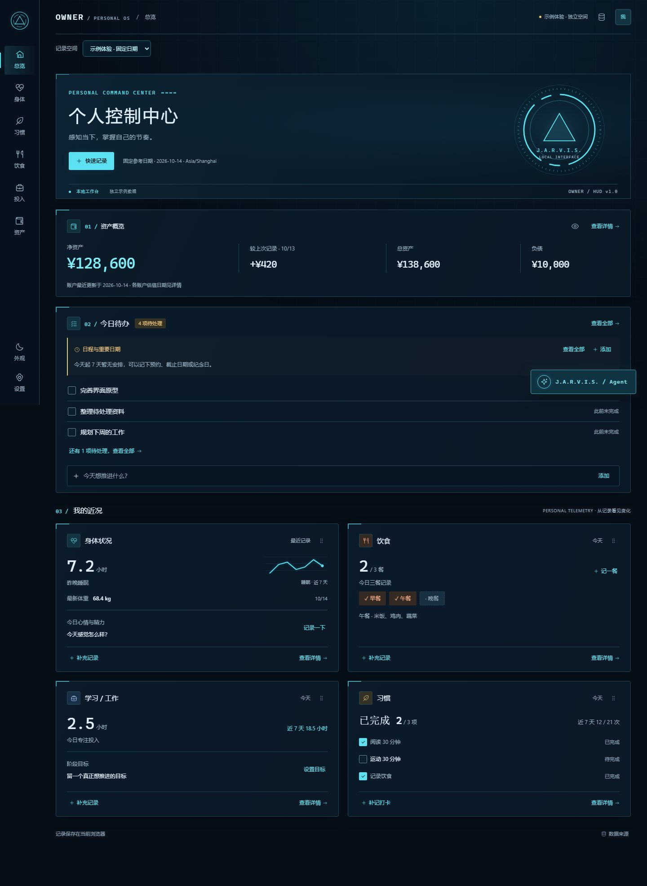

# Owner 1.0.0 · 本地第一版

日期：2026-10-28。范围：实现计划 P0–P4。运行形态：浏览器内、本地优先、中文 HUD；数据来源为手动记录及明确隔离的示例 / 原型。

## 交付内容

工程基础与 React 界面、真实日期与可靠存储、各领域记录闭环、备份恢复，以及统计图表均已完成本地验收。保留资产 → 待办 / 日程 → 近况的顺序和右侧展开 Agent。发布门槛为目标提交的 Linux、Windows、Chromium 三项 CI 均成功，再合并 main、创建 v1.0.0 标记和 Release；最终提交与资产以 [GitHub Release](https://github.com/Zzhi66/Owner/releases/tag/v1.0.0) 为准。

| 门槛 | 证据与范围 |
| --- | --- |
| 工程与原型保护 | npm run verify；构建固定写 build/，构建前后核对 dist/ 文件树及 SHA-256 |
| 自动测试 | 139 项、9 个测试文件；覆盖日期、统计、迁移、事务、记录、备份、冲突、Agent 输入和生产依赖边界 |
| 实际浏览器 | 10 项 Playwright Chromium 验收，使用一次性上下文和独立 5187 来源 |
| 响应式与触屏 | 375 / 768 / 1024 / 1440 的总览与五个详情、真实图表；375 触屏事件、排序、浮窗和表单；独立来源另检查四屏宽弹窗与 Agent 三标签 |
| 键盘与导航 | 路由刷新、前进后退、未知 hash 回退、点击 / 拖动 / 左右键排序；焦点返回、Esc 分层关闭、标签方向键 / End、中文组合事件、Enter / Shift+Enter |
| 动态效果 | 独立浏览器切换 no-preference → reduce，确认媒体查询生效，按钮过渡为 0s、Agent 入场动画为 none；未改变系统设置 |
| 写入失败 | 仅在临时上下文注入一次 IndexedDB 配额错误；草稿保留，真实事务无半条记录，可重试并刷新保留 |
| 旧数据保护 | 临时浏览器的损坏 localStorage 禁止迁移，原文保持不变且可下载；其余迁移 / 关联 / 事务边界继续由已有测试覆盖 |
| 备份与恢复 | 文件实际下载、坏 JSON / 未知版本 / 超限文件拒绝、独立副本、替换前恢复点、回退再保护、实体关联保留；原空间记录逐项对比未变 |
| Agent | 运行中收起仍完成；刷新后的过期任务中断且不伪造产物；实际复制、Markdown 下载与刷新保留；输出明确标注本地演示 |
| 构建 | 19 个 JS 分包、每包 ≤500 kB，首屏不静态加载图表引擎，没有远程脚本 / 样式，没有 React 开发版代码 |

对应测试位于 `tests/`、`tests/e2e/`。阶段历史记录见 [P1](P1_REACT_MIGRATION.md)、[P2](P2_DATE_STORAGE.md)、[P3](P3_RECORDS_BACKUP.md)、[P4](P4_CHARTS_RELEASE.md)；收尾操作记录见 [V1 核对](V1_DELIVERY.md)。未将数据库模拟测试描述成修改真实设备时钟或耗尽真实磁盘。

## 收尾修复

- 六点按钮增加点击前移 / 后移，支持单指操作，保留拖动和键盘排序。
- 修正标题层级和搜索框吞掉首次 Esc 的行为，保留输入法组合态。
- 输入法组合结束边界继续检查 keyCode 229，避免确认候选字时提前发送。依据 [MDN 输入法键盘事件说明](https://developer.mozilla.org/en-US/docs/Web/API/Element/keydown_event#keydown_events_with_ime)。
- 构建前显式设置 production；原脚本提前调用 resolveConfig 时采用了开发默认值，导致 React 开发代码进入产物。新增审计防止回归，依据 [Vite 环境与模式](https://vite.dev/guide/env-and-mode#node-env-and-modes)。
- 用 ECharts 6 的 outerBoundsMode / outerBoundsContain 替代旧 containLabel，保持轴标签布局且避免遗漏兼容模块。依据 [ECharts 6.1 GridOption](https://github.com/apache/echarts/blob/6.1.0/src/coord/cartesian/GridModel.ts)。

生产入口约 68.39 kB、React 分包约 218.76 kB、共享图表引擎约 478.97 kB。修复前对应约 92.32 / 425.67 / 493.93 kB；这些是未压缩构建大小，首屏还有数据库及校验依赖，不等于已经做长期性能基准。

## 界面对照

以下截图仅使用固定 2026-10-14 的独立示例空间，不含个人记录。

[窄屏总览](screenshots/owner-v1-overview-mobile.jpg) · [窄屏 Agent](screenshots/owner-v1-agent-mobile.jpg)

## 数据兼容与运行

数据库仍为 `owner.workbench.v2`、schema 3，完整备份格式仍为 v1。没有清空 localStorage、平移历史日期或替换个人记录。浏览器、协议、域名和端口决定记录来源，建议继续使用原有 `http://127.0.0.1:4173`。切换来源前先导出完整备份，再通过独立恢复副本导入。详见 [数据口径与恢复指南](DATA_AND_RECOVERY.md)。

从源码运行：`npm ci`、`npm run dev`；生产预览：`npm run build`、`npm start`（默认 5175，与 4173 的数据隔离）。静态产物需通过 HTTP 服务打开，不以双击 file:// 作为交付入口。

独立手工验收来源 5186 的活动身体、心情、餐食、投入、账户、待办、日程、目标和随手记均已清理；为追溯保留测试资产估值、快照、回收站、恢复点及规则演示产物。Playwright 上下文执行完即销毁。测试下载、数据库、备份和追踪均未提交 Git。

## 当前边界

Agent 尚未连接模型或执行外部任务；没有设备接入、云同步、跨端账户、重复日程、系统通知、Three.js 或桌面安装包。离线检查覆盖已加载模块的本地操作，未提供 PWA 离线冷启动。验收浏览器为 Chromium，未声称覆盖所有浏览器、实体手机或长期海量记录压力。后续按 P5–P7 单独实施。
